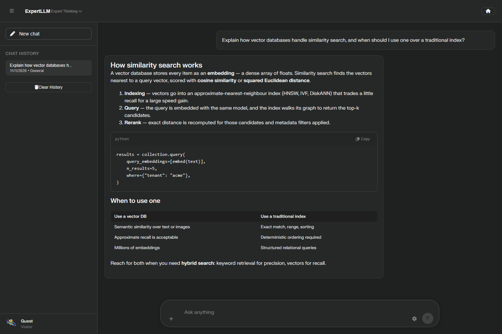
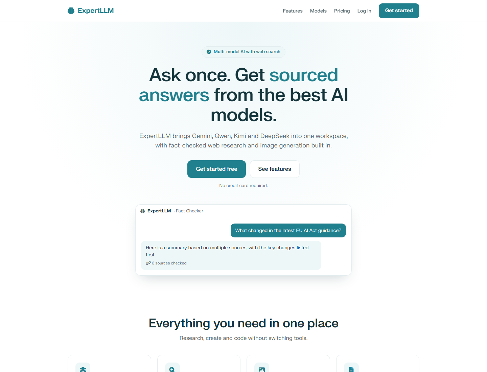

# ExpertLLM

A multi-model AI workspace with a sourced-research agent, image generation,
and file/OCR input. Laravel JSON API, Blade frontend, no build step.



<details>
<summary>Landing page</summary>



</details>

## What you get

Ask a question and get an answer with numbered citations you can click through
to the source. Switch between seven models across three providers mid-conversation.
Generate and edit images. Drop in PDFs, Word documents, images, or audio and ask
about them.

## Why the repo is shaped like this

ExpertLLM started as one `index.html`: markup, roughly 3,800 lines of CSS and
8,000 lines of JavaScript, talking to a Node/Express server. It worked, and it
stopped being workable. Every feature lived in the same file, so changing the
search pipeline meant navigating ten thousand unrelated lines, and no part of it
could be tested without loading the whole page.

I rebuilt the backend in Laravel as a stateless JSON API, splitting auth, chat,
images, the model proxy, search and fetching into separate controllers and
services. The constraint I set was that the interface and behaviour would not
change. The original `index.html` and `server.js` are still in the repository
root, kept because the browser-side request builders are the reference for what
the new API has to return.

## The research loop

Fact Checker mode is a four-step tool-use loop:

1. The model drafts several search queries for the question.
2. The queries go to a web search provider (`/search`): Serper, Tavily or Brave,\n   or legacy Google Programmable Search. Results are normalised to one shape.
3. The top result pages are fetched and reduced to their text content, with
   scripts, navigation and boilerplate stripped (`/fetch-content-batch`).
4. The model synthesises an answer that cites the pages it used. Citations render
   as numbered chips carrying the source's favicon.

The model never receives raw HTML. It receives extracted text: smaller, cheaper,
and without the scripts, styles and comments that carry much prompt
injection. Instructions written as visible page text still reach the model, so
fetched pages are treated as untrusted input (see below).

## Designing against failure

A fetch tool is an SSRF machine by default. Three guards here are deliberate
rather than incidental, and each exists because of a specific way the system
could be turned against its owner.

**The fetcher refuses to reach inside the network.** `WebFetcher` rejects
loopback, private, link-local and cloud-metadata addresses. Redirects are followed
by hand, up to five hops, and every hop goes through the same check, so a page that
redirects to `169.254.169.254` gets an error instead of a signed identity token.

**The Vertex proxy is not an open proxy.** It accepts only URLs matching
`https://…aiplatform.googleapis.com/v1/projects/<VERTEX_PROJECT_ID>/…` and mints
its own OAuth token. You cannot point it at another project or another API and
have it sign the request for you.

**Keys never reach the browser.** Provider credentials live in `.env`; the
frontend names a provider, never a key. An earlier version signed JWTs in the
page using a service-account private key. That path was removed rather than
hidden.

The test suite covers all three. The SSRF suite asserts that loopback, private,
link-local and metadata URLs are refused.

### What is still weak

I would rather name these than have a reader find them.

- The fetch guard resolves a URL and then fetches it. DNS rebinding between those
  two steps is not closed.
- There is no headless-browser tier, so JS-only pages return a per-URL error that
  the frontend skips rather than retrying.
- Visible-text prompt injection in a fetched page is not filtered; the model's
  answer is not checked against the page for injected instructions.
- Generated images are stored as base64 in the database. Fine at current volume,
  wrong past it.

## Models

Seven models across three providers, switchable per conversation from the header
dropdown:

| Name | Provider | Model |
| --- | --- | --- |
| Fast | Google Vertex | `gemini-3-flash-preview` |
| Thinking | Google Vertex | `gemini-2.5-pro` |
| Expert Thinking | Google Vertex or Gemini API | `gemini-3.1-pro-preview` |
| Gemini Argon | Gemini API (paid tier; thinking level fixed to high) | `gemini-4-argon` |
| Deep Thinking | Chutes | `Qwen/Qwen3-235B-A22B-Thinking-2507` |
| DeepSeek V3.1 | OpenRouter | `deepseek/deepseek-chat-v3.1:free` |
| Kimi K2 | Vertex MaaS | `kimi-k2-32k-maas` |
| Kimi K2 Thinking | Vertex MaaS | `kimi-k2-thinking-maas` |

Responses stream token by token, with rendered Markdown, syntax-highlighted code,
tables, and MathJax (`\[…\]` and `$$…$$`).

## Architecture

```
routes/web.php ──► Blade shell (landing + chat + modals)
                   resources/views/layouts/app.blade.php
                   resources/views/partials/*.blade.php
                   public/css/*.css, public/js/*.js   (no build step)

routes/api.php ──► app/Http/Controllers/Api/*          (mounted at /)
                   ├── AuthController      register / login
                   ├── UserController      profile, preferences
                   ├── ChatController      sessions, messages, history
                   ├── ImageController     generated + uploaded images
                   ├── ProxyController     Vertex AI, OpenRouter, Chutes
                   ├── SearchController    Google Programmable Search
                   └── FetchController     page text extraction
                   app/Services/
                   ├── TokenService        HS256 bearer tokens, rolling refresh
                   ├── VertexTokenService  OAuth via metadata server or service account
                   └── WebFetcher          SSRF-guarded page fetching
```

Design notes:

- **Stateless auth.** Every API request carries `Authorization: Bearer <token>`
  and gets a refreshed token back in `X-Auth-Token`, so a session never expires
  mid-conversation.
- **No keys in the browser.** The frontend names a provider, never a credential.
- **The proxy mints its own tokens** and refuses any URL outside the configured
  project.

## Setup

```bash
composer install
cp .env.example .env
php artisan key:generate
php artisan migrate
php artisan serve
```

Open http://localhost:8000 and create an account from the landing page. No
provider keys are needed to browse the interface; chat and search need the
variables below.

### Configuration

| Variable | Purpose |
| --- | --- |
| `JWT_SECRET` | HMAC key for API tokens. Falls back to `APP_KEY`. |
| `GEMINI_API_KEY` | Gemini API key from Google AI Studio. When set, Gemini models use it via `/gemini-proxy` and Vertex is not needed. |
| `VERTEX_PROJECT_ID` | Google Cloud project used by the Vertex proxy and sent to the frontend. |
| `VERTEX_SERVICE_ACCOUNT_JSON` | Service-account JSON, inline. |
| `GOOGLE_APPLICATION_CREDENTIALS` | Alternative: path to a service-account file. |
| `USE_METADATA_SERVER` | Use the GCE metadata server for Vertex tokens. |
| `OPENROUTER_API_KEY` | OpenRouter key for `/chat/completions`. |
| `CHUTES_API_KEY` | Chutes key for `/chat/completions`. |
| `SEARCH_PROVIDER` | `serper`, `tavily`, `brave` or `google`. Blank = first provider with a key. |
| `SERPER_API_KEY` | Serper (Google results). |
| `TAVILY_API_KEY` | Tavily. |
| `BRAVE_SEARCH_API_KEY` | Brave Search. |
| `GOOGLE_SEARCH_API_KEY` + `GOOGLE_SEARCH_CX` | Legacy Google Programmable Search (closed to new customers). |
| `GOOGLE_SEARCH_KEYS` | Optional JSON array of `{apiKey, cx}` for Google key rotation. |

## API

| Method | Path | Purpose |
| --- | --- | --- |
| POST | `/auth/register`, `/auth/login` | Issue a token |
| GET | `/user/me` | Current profile |
| POST | `/user/preferences` | Save UI preferences |
| GET | `/chat/sessions` | List sessions |
| DELETE | `/chat/sessions/{id}` | Delete a session |
| POST | `/chat/message` | Persist a message |
| GET / DELETE | `/chat/history` | Read or clear history |
| POST | `/images/save` | Store a generated image |
| GET | `/images/last`, `/images/session` | Generated-image lookups |
| POST | `/images/upload` | Batch-store uploaded images |
| GET / DELETE | `/images/uploaded`, `/images/uploaded/{id}` | Uploaded images |
| GET / DELETE | `/images/{id}` | Generated image (`?raw=true` for bytes) |
| POST | `/vertex-proxy` | Vertex AI proxy (URL allow-listed) |
| POST | `/gemini-proxy` | Gemini API proxy (model name only, key held server-side) |
| POST | `/chat/completions` | OpenRouter / Chutes proxy |
| POST | `/search` | Web search (provider-neutral) |
| POST | `/fetch-content`, `/fetch-content-batch` | Page text extraction |

## Tests

```bash
php artisan test
```

41 tests cover:

- registration, duplicate usernames, login normalisation, and token refresh
- 401 vs 403 behaviour and profile/preference persistence
- session creation with derived titles, cross-user session isolation, history
  ordering, and cascade deletes
- image storage, raw byte streaming, and per-user visibility
- the Gemini proxy accepting only `gemini-*` model names and forwarding
  `maxOutputTokens` and `thinkingLevel` with the server-held key
- search providers returning one result shape, provider selection, and failures
  that do not leak the key
- the SSRF guard refusing loopback, private, link-local and metadata URLs, including
  when a public URL redirects to one (single and batch fetch)

## Production notes

- Set `APP_ENV=production`, `APP_DEBUG=false`, and a strong `JWT_SECRET`.
- Use MySQL or PostgreSQL; SQLite is the development default.
- Serve through nginx/Apache + PHP-FPM, not `php artisan serve`.
- Images are stored as base64 in the database. Move to object storage if volume
  grows.
- The fetch endpoint blocks private and metadata addresses but not DNS rebinding
  between resolution and request.
- No headless-browser tier: JS-only pages return a per-URL error the frontend
  skips.

## Licence

No licence is granted. This repository is public so the code can be read and
reviewed. All rights are reserved.
